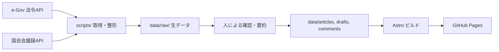

# 設計資料: japan-constitution-review

日本国憲法と改憲案の論点・リスクを、コードレビュー形式で検証するサイトの設計をまとめた資料です。
現時点の設計案であり、実装を進める中で更新します。

- 最終更新: 2026-11-01
- ステータス: 設計案(`data/articles/` のスキーマは確定、`data/drafts/` は未確定)

---

## 1. 目的とコンセプト

### 目的

日本国憲法を「コードベース」、改憲案を「プルリクエスト」に見立て、エンジニアの視点で次の点を明らかにする。

- 現行憲法の仕組み(誰が・何を・どの条件で判断できるか)
- 改憲案が加える権限と、外れる歯止め
- 改憲した場合のリスクと、現状のまま維持した場合の課題

### サイトの立場

- 主眼は**中立**であり、立場はサイト上に明記する。
- 信頼性を担保するため、次を守る。
  - 現行憲法のままの課題も、課題として載せる
  - 改憲を支持する側の論拠を、最も強い形で併記する
  - 事実・解釈・意見・引用を区別して表示する

### 非目標

- 特定の政党・政治家の支持や不支持の呼びかけ
- 条文の法的な有権解釈の提供(参考資料であり、法的助言ではない)
- ユーザー投稿やコメント機能(静的サイトとして運用する)

---

## 2. 技術スタック

| 領域 | 採用 | 理由 |
| --- | --- | --- |
| フレームワーク | Astro + TypeScript | 条文ごとの静的ページを事前生成でき、SEOに強い |
| データ取得 | Python スクリプト | e-Gov 法令API、国会会議録検索APIからの取得・整形 |
| 差分表示 | jsdiff + 自作コンポーネント(または diff2html) | 改憲案と現行条文の差分を PR 風に描画 |
| 検索 | Pagefind | 静的サイト向け全文検索。サーバー不要 |
| スタイル | Tailwind CSS(または GitHub Primer 風 CSS) | GitHub 風 UI を作りやすい |
| ホスティング | GitHub Pages | 静的で完結。独自ドメインは後から追加可能 |
| CI/CD | GitHub Actions | ビルド、データ検証、リンク切れチェック |

### GitHub Pages 利用時の注意

- リポジトリ配下で公開されるため、`astro.config.mjs` で `base` を設定する。
- 独自ドメインへ移行する際は `base` を外すだけで済む。
- HTTPヘッダーやリダイレクトを細かく制御できない。サーバー処理が必要になった場合は Cloudflare Pages などを検討する。

```js
export default defineConfig({
  site: 'https://yadorigi-9-go.github.io',
  base: '/japan-constitution-review',
});
```

---

## 3. リポジトリ構成

```plaintext
japan-constitution-review/
├── data/
│   ├── raw/          # APIから取得した生データ(.gitignore、再生成可能)
│   ├── articles/     # 条文(1条文1ファイル、人が確認済み)
│   ├── drafts/       # 改憲案(案ごとにディレクトリ)
│   └── comments/     # 発言・論点レビュー(条文単位)
├── scripts/          # Python: データ取得・整形・検証
├── src/
│   ├── pages/        # 条文ページ、改憲案ページ、論点一覧
│   ├── components/   # コメント、差分、ラベルなどのUI部品
│   └── lib/          # データ読み込み、diff生成
├── docs/
│   └── design.md     # 本資料
└── .github/workflows/
```

方針: **再生成できるものは Git に入れず、人が確認したデータだけをコミットする。** 出典の追跡が容易になる。

---

## 4. データフロー



- 自動取得した発言は**候補**として扱い、人が文脈を確認してから `comments/` に登録する。
- ビルド時に、スキーマ検証と必須項目チェックを CI で実行する。

---

## 5. データモデル(案)

### 5.1 条文 `data/articles/art-009.yaml`

```yaml
kind: article   # article | preamble
id: art-009
chapter: 第二章
number: 9
paragraphs:
  - no: 1
    text: "(条文の本文)"
source_url: "(e-Gov の該当ページ)"
retrieved_at: 2026-10-31
```

`id` はファイル名(拡張子を除いた部分)と完全一致させる。条文番号は3桁にゼロ埋めする(`art-009`)。文字列として並べ替えたときに数値順と一致させるため。

前文(`data/articles/preamble.yaml`)は章・条文番号を持たないため、`kind: preamble` として `chapter` / `number` を省いた別形式で扱う。`paragraphs[].no` は e-Gov の構造化データ上の段落区切りを表示用に流用したものであり、前文自体に公式な段落番号は存在しない(画面上もその旨を明記する)。

```yaml
kind: preamble
id: preamble
paragraphs:
  - no: 1
    text: "(前文第1段落)"
source_url: "(e-Gov の該当ページ)"
retrieved_at: 2026-10-31
```

現行憲法の第十一章「補則」(第100条〜第103条)は、別立ての「附則」ではなく通常の条文スキーマ(`kind: article`)にそのまま収まる。

### 5.2 改憲案 `data/drafts/<draft-id>/`

```plaintext
data/drafts/<draft-id>/
├── meta.yaml          # 名称、提案主体、公表日、出典URL
└── art-009.yaml       # 変更後の条文(変更・追加のあった条文のみ)
```

- 現行条文との差分は、ビルド時に生成する(差分自体は保存しない)。
- 新設条文は `art-<番号を3桁0埋め>-2` のように枝番で表す(例: `art-009-2`)。

### 5.3 コメント `data/comments/art-009/<id>.yaml`

以下は構造を示すための**架空のサンプル**であり、実在の発言ではない。

```yaml
id: c-0001
article_ids: [art-009]
draft_id: null              # 改憲案へのコメントなら draft-id
kind: speech                # speech | review | embed
claim_type: quote           # fact | interpretation | concern | quote
stance: oppose              # support | oppose | neutral(発言者本人の立場表明に限る)
source_type: primary        # primary | news | organization
speaker:
  name: "<発言者>"
  role: "<肩書き>"
  party: "<会派>"
date: 2026-01-01
venue: "<会議名>"
excerpt: "<短い抜粋>"      # 全文転載はしない
summary: "<自分の言葉による要約>"
summary_source: ai          # human | ai (summary を書いたのが人かAIかを明示し、画面にも表示する)
source_url: "<会議録URL>"
archive_url: "<アーカイブURL>"
accessed_at: 2026-10-31
tags: [緊急事態, 権限集中]
verified: true
```

### 5.4 フィールドの意味

| フィールド | 目的 |
| --- | --- |
| `claim_type` | 条文上の事実、解釈、懸念・予測、発言の引用を区別する |
| `stance` | 賛否ラベル。発言者本人の立場表明に限り、サイト側の評価は入れない |
| `source_type` | 一次資料(条文・会議録)、報道、団体・政党の見解を区別する |
| `archive_url` / `accessed_at` | 元ページ・投稿の削除に備え、根拠を残す |
| `verified` | 人の確認が済んでいるか。未確認は公開しない |
| `summary_source` | `summary`(要約)を書いたのが人かAIかを示す。AIの場合は画面上に「AIによる要約」と明記する(`excerpt` は発言そのものの抜粋なので対象外) |

---

## 6. 画面設計

GitHub のUIを参考にする。配色・部品だけでなく、ヘッダー構成・タブ・diffの行番号ガター・コメントのアバター配置など、レイアウト構造もGitHubの実際のパターンに近づけてよい(2026-11-01、方針緩和)。ただし、ロゴ・「GitHub」という名称・Octocat等の商標は使わない。

| 画面 | GitHub での対応 | 内容 |
| --- | --- | --- |
| 憲法トップ | リポジトリのトップ | 章・条文の一覧(ファイルツリー風) |
| 条文ページ | ファイル表示(blame風) | 本文。行ごとにコメント件数を表示 |
| 条文へのコメント | コードレビューコメント | 発言・論点レビューを行に紐づけて表示 |
| 改憲案一覧 | Pull requests | 改憲案を PR として一覧 |
| 改憲案詳細 | Files changed | 現行条文との diff と、行コメント |
| 論点一覧 | Issues | 論点・リスク・現状維持の課題をラベルで分類 |

---

## 7. 論点・リスクのレビュー観点

改憲案の各条項を、システム設計のレビューと同じ観点で検証する。

1. **権限の付与**: 誰に、何を、どの条件で認めるか
2. **歯止め**: 事前承認・事後承認、期間制限、司法審査の有無
3. **判断基準**: 発動条件の文言は定義されているか。誰が判断するか
4. **濫用シナリオ**: 最悪の運用ケースと、それを防ぐ仕組みの有無
5. **現行制度との差分**: 現行憲法・既存法令で対応できているか
6. **現状維持のリスク**: 改憲しない場合に残る課題(対称的に記載する)

各論点には「改憲を支持する側の主張」を併記し、そのうえで検証を示す。

---

## 8. 出典・著作権・利用規約の方針

> 法的助言ではない。公開前に、必要に応じて専門家へ確認する。

### 国会での発言

- 公開された政治上の陳述は、著作権法40条1項により、同一の著作者のものを編集して利用する場合を除き、利用できる。
- **「同一の著作者のものを編集」に当たる設計を避ける**: 構成は条文単位とし、特定の政治家の発言をまとめたページは作らない。
- 全文転載はせず、**短い抜粋 + 会議録へのリンク**とする(引用の要件も意識する)。
- 切り取りによる意味の改変を避けるため、文脈を示すリンクを必ず付ける。
- 国会会議録検索システムの**利用規約**を確認済み(2026-11-01)。
  - API利用に申請・登録は不要。
  - レート制限: 多重リクエスト禁止。取得後は数秒程度の間隔を空けて次のリクエストを行う。短時間での大量アクセスは不可(違反時は予告なく遮断されうる)。
  - 1リクエストの上限: 発言単位・会議単位簡易出力は100件、会議単位出力は10件、検索条件は2000バイトまで。
  - 発言データ自体の著作権は発言者に帰属し、NDL全体の「ウェブサイト利用規約」(公共データ利用規約1.0準拠)は及ばない。上記の著作権法40条1項・引用規定の範囲で利用する。
  - `scripts/` で取得スクリプトを書く際は、上記のレート制限を必ず守る。

### 映像・SNS

- 国会中継などの映像自体の著作権は40条の対象外と考えられるため、**転載しない**(公式配信の埋め込みまたはリンクにする)。
- SNS・YouTube は埋め込み(Embed)を基本とする。
  - 外部スクリプトを読み込むため、**クリック時に読み込む方式**にする(プライバシーと表示速度)
  - 投稿の削除に備え、要旨・日付・投稿者と `archive_url` を自前データに残す

### 表現上のルール

- 実在の政治家に関する記述は、**発言内容の事実記述にとどめ**、評価語を使わない。
- 各ページに「最終確認日」と出典を明記する。

---

## 9. SEO・公開

- 条文・改憲案ごとの固有URL(静的生成)
- `title` / `description` / OGP、`sitemap.xml`、canonical
- 構造化データ(法令の条文として扱える形式を検討)
- 純粋なSPAにしない(HTML をビルド時に生成する)
- 独自ドメインを取得する場合は、ユーザー名が URL に出ないようにできる

---

## 10. 運用・品質管理

GitHub Actions で次を自動化する。

| チェック | 内容 |
| --- | --- |
| スキーマ検証 | YAML の必須項目・列挙値を検証 |
| リンク切れチェック | `source_url` と `archive_url` を定期確認 |
| 未確認データの除外 | `verified: false` のコメントは公開しない |
| ビルド・デプロイ | main へのマージで GitHub Pages に公開 |

- 改憲をめぐる議論は動きやすいため、各ページに「最終確認日」を表示し、定期的に更新する。
- 変更はプルリクエストでレビューし、出典の確認を必須にする。

---

## 11. ライセンス

- ソースコード: MIT License
- 条文・会議録など、第三者が提供するデータ: 各提供元の利用条件に従う

---

## 12. ロードマップ

1. スキーマ確定、サンプル条文(数条)で表示を試作
2. 条文の一括取得と全条文ページの生成
3. コメント表示(行コメント風UI)
4. 改憲案の差分表示(PR風UI)
5. 論点一覧(Issues 風)、全文検索
6. 公開、SEO 設定、CI の整備

## 13. 未決事項

- 改憲案(`data/drafts/`)側の枝番条文・附則のスキーマ詳細(現行条文の前文・補則の扱いは5.1で確定済み)
- 取り上げる改憲案の範囲と、各案の出典の確定
- 独自ドメインの取得をするか
- 論点一覧(`data/issues/`、ロードマップ5)の要否・実装時期。AIによる解説文章はバイアスの懸念があるため保留し、まずは実在の政治家の発言コメント(`data/comments/`)の収集を優先する方針に転換した(2026-11-01)
